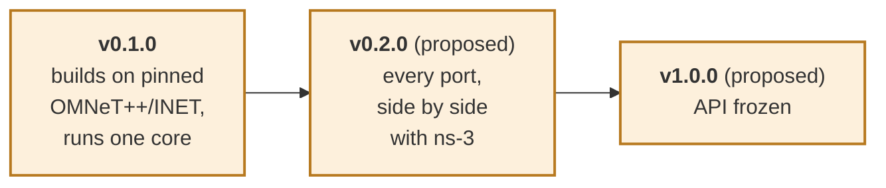

# Roadmap

The plan in one page: which release each piece of work serves, and what each
release must show to ship. The live plan is this page plus the `release:`
labels below; issue state is always truer than a checked-in diagram. The
org-wide view (the release train, decisions 8, 23 and 24) is the
[org ROADMAP](https://github.com/swarm-routing/.github/blob/main/ROADMAP.md).
The shape follows
[swarm-adapter-ns3's roadmap](https://github.com/swarm-routing/swarm-adapter-ns3/blob/main/docs/roadmap.md):
themed minor releases `vX.Y.0`, an exit-criteria table per release, and
deliberate non-goals.

## How this plan is tracked

Each issue a release gates carries a **`release:` label**, so every row of
this plan is a live query. The implementation epic is #2.

| Release | Board |
|---|---|
| v0.1.0 | [`release:v0.1.0`](https://github.com/swarm-routing/swarm-adapter-omnet/issues?q=is%3Aopen+label%3A%22release%3Av0.1.0%22) |
| v0.2.0 (proposed) | [`release:v0.2.0`](https://github.com/swarm-routing/swarm-adapter-omnet/issues?q=is%3Aopen+label%3A%22release%3Av0.2.0%22) |
| v1.0.0 (proposed) | [`release:v1.0.0`](https://github.com/swarm-routing/swarm-adapter-omnet/issues?q=is%3Aopen+label%3A%22release%3Av1.0.0%22) |
| all epics | [`epic`](https://github.com/swarm-routing/swarm-adapter-omnet/issues?q=is%3Aopen+label%3Aepic) |

Only issues the ladder gates are labelled, one release label per issue.
Releases are cut on the maintainer's request only (CONTRIBUTING "Cutting a
release"); `release.yml`'s ladder gate refuses a version with no row below.

## Release ladder

Amber releases are planned and not yet shipped.

## Exit criteria

| Release | Theme | Exit criteria |
|---|---|---|
| v0.1.0 | the module builds against a pinned OMNeT++ release and runs one protocol core | The OMNeT++/INET module builds against the pair [install.md](install.md) pins (OMNeT++ 6.5.0, INET 4.6.0) and the swarm-core release `swarm-core.lock` names; CI builds and tests it on the OMNeT++/INET image from swarm-routing/sim-containers, and its build and test checks are required (`[settings]`); the clock, RNG, timer, deferred-queue, neighbour/link-state and control-send ports are carried out on INET, each with a glue test; one protocol core (AntHocNet's) runs in an example network and a fixed seed gives byte-identical output (golden rule 5); `make dist` builds the release tarball and the module's vcpkg port exists in swarm-routing/vcpkg-registry; docs/install.md describes the real steps. |
| v0.2.0 (proposed) | adapter complete, side by side with ns-3 | Every port swarm-core defines at the locked release is carried out; a second protocol core runs; a sim-tools run of the same scenario on ns-3 and OMNeT++ is recorded, labelled qualitative (decision 8). |
| v1.0.0 (proposed) | API frozen | This repository's own `docs/api-policy.md` (after swarm-adapter-ns3's) and an API record checked in CI; the downstream protocols build their OMNeT++ arm against it. |

## Non-goals

- **Routing logic.** No decision rule lives here (golden rule 10); this
  ladder never gains a protocol feature.
- **Published numbers from OMNeT++.** Cross-simulator results confirm a
  ranking; they are not paper numbers (decision 8).
- **Veins, Simu5G or other INET-based frameworks.** Out of scope until the
  maintainer plans them (swarm-routing/.github#48).
- **OMNeT++ versions other than the pinned pair** in CI.
